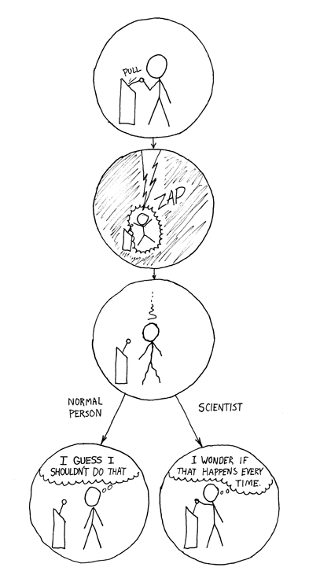

# shaikiriati.github.io
**Shai Kiriati's repository**

PhD student in Elbaum group, Weizmann Institute of Science

Working on 4DSTEM of thick biological samples (ask me more!)

**About me today**
- Physicist by training, but interested in mostly everything
- Love singing, playing guitar and bass and playing TTRPGS
- Say hi to my dog Max!  

**About my history**
- MSc in Physics from Weizmann
- BSc in Physics from Technion
- Worked as a translator
- High school final research project: Creating universal quantum computation gates with parity measurements
- Tried (and failed) to make a startup in cleantech during high school
- Did university debate (BP) and high-school MUN

**Skills**
- Languages: Hebrew (fluent), English (fluent), Arabic (mostly alphabet, want to learn more)
- Languages (programming): Python, Matlab, C# (some), C (very little), Mathematica (please don't)
- Teaching
- Asking too many questions

_The reason I'm here_
(source: XKCD)
