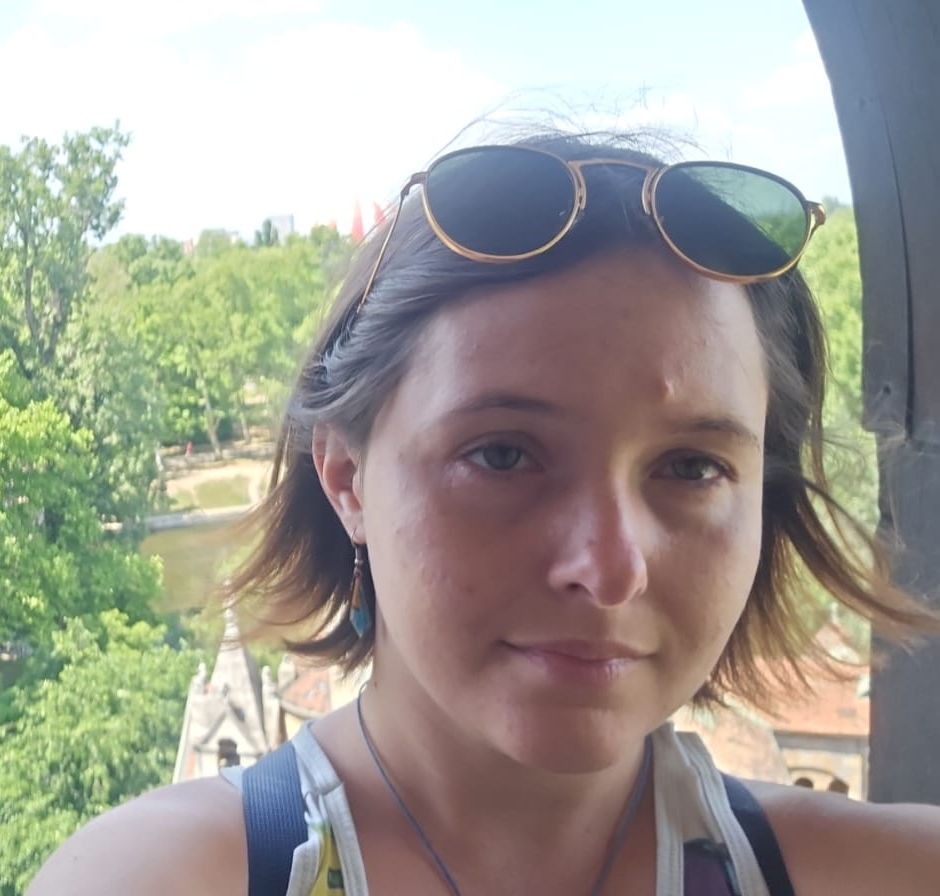
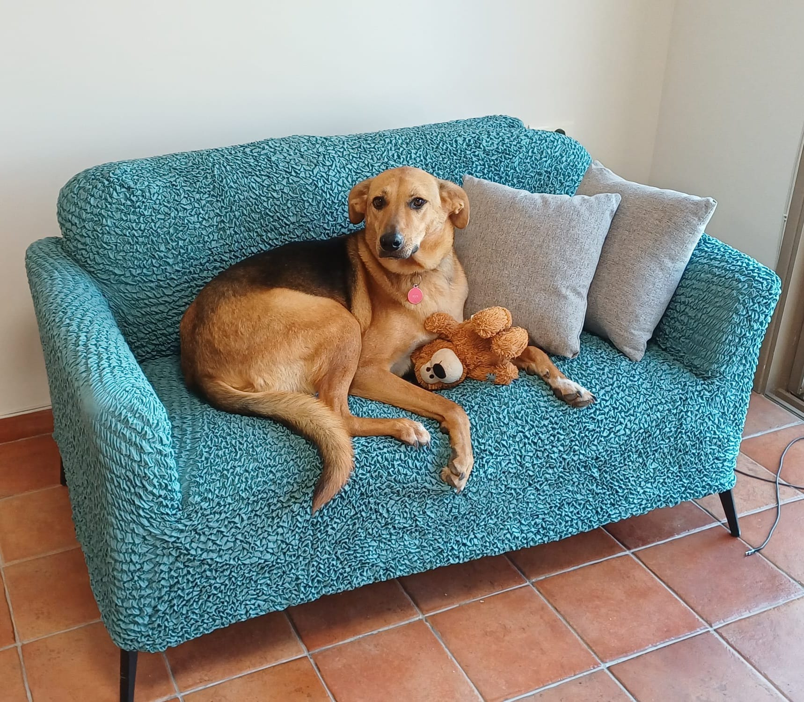

<h1>Shai Kiriati's repository</h1>

<b><i>PhD student in Elbaum group, Weizmann Institute of Science</i></b>

<b><i>Working on 4DSTEM of thick biological samples (ask me more!)</i></b>

## About me today
- Physicist by training, but interested in mostly everything
- Love singing, playing guitar and bass and playing TTRPGS
- Say hi to my dog Max!

  

## About my history
- MSc in Physics from Weizmann
- BSc in Physics from Technion
- Worked as a translator
- High school final research project: Creating universal quantum computation gates with parity measurements
- Tried (and failed) to make a startup in cleantech during high school
- Did university debate (BP) and high-school MUN

## Skills
- Languages: Hebrew (fluent), English (fluent), Arabic (mostly alphabet, want to learn more)
- Languages (programming): Python, Matlab, C# (some), C (very little), Mathematica (please don't)
- Teaching
- Asking too many questions

---

<i>The reason I'm here</i>

